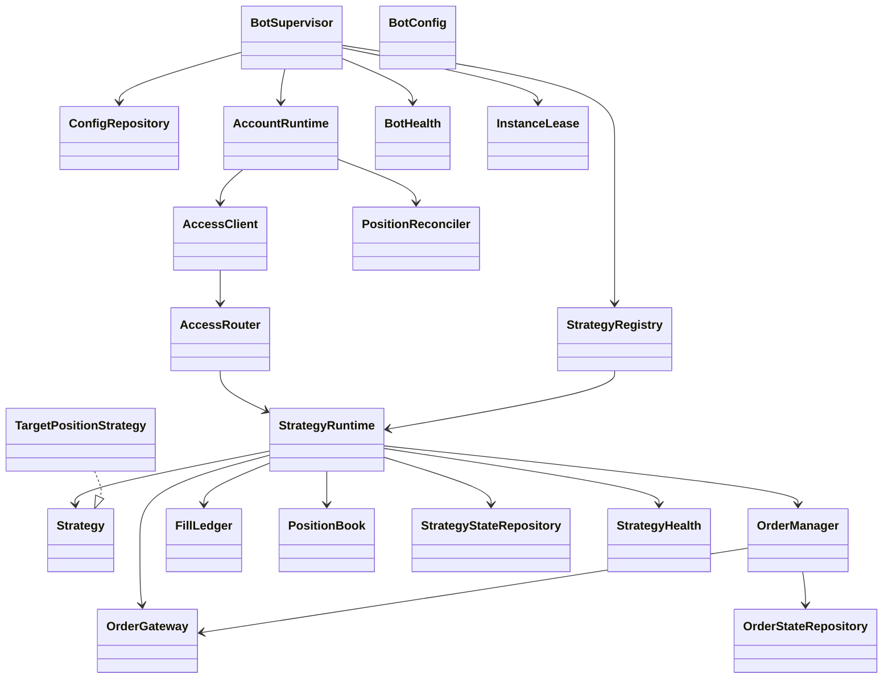

# FastTrade 骨架设计：Skeleton + Demo

- 日期：2026-11-18
- 状态：DRAFT（待批准）
- 目标：把 FastTrade 从“单策略 demo”改成“一个可扩展骨架 + 一个 TargetPosition demo”

## 1. 问题

当前代码能跑通单策略、单账户、单合约、单 open order，但扩展点不成立：

- `TradeBotMain` 直接 `new` 一个 `AccessClient`、一个 `OrderManager`、一个 `TargetPositionStrategy`；
- `TargetPositionStrategy` 是 final 具体类，没有 `Strategy` 接口；
- `BotListener` 只有一个 `strategy` 和一个 `orders`；
- `AccessClient` 只有一个 `AccessListener`，execution/trade 里的 `strategyKey` 只写日志，不做路由；
- `OrderManager` 只有一个 open order；
- `StateStore` 只存一个 open order 和 `lastClientOrderId`，是文件；
- `TargetPositionStrategy` 用账户净仓 `PositionSnapshot` 作为策略仓位；
- `TradeBotConfig` 只有一组策略参数；
- `TradeBotHealth` 只有一个策略的状态；
- 部署只有一个 `STRATEGY_KEY`、一个 service。

这不是“加一个策略类”能解决的，而是组合根和状态模型的问题。

## 2. 对 MVP 的定义

MVP 不是“只实现一个功能”。MVP 是：

```text
一个可运行的骨架
  + 一个可替换的 demo 策略
  + 一条真实跑通的订单/成交/仓位链路
  + 一套能在不改变骨架的情况下增加第二个策略的接口
```

demo 策略就是 `TargetPositionStrategy`：目标仓位 + 限价单 + 撤销/重报。
骨架本身必须支持 N 个策略、至少一个账户、每个策略独立订单/仓位/状态/健康。

## 3. 目标

1. 一个进程内运行 N 个策略；demo 只启用 1 个。
2. 增加策略只改：配置 + `Strategy` 实现 + `StrategyFactory`，不改 `BotSupervisor`、`AccessClient`、仓储、健康聚合。
3. 每个策略独立：
   - open order（每个策略仍只允许一个 open order）
   - fill ledger
   - position book
   - state
   - health
   - `clientOrderId` 由账户级 DB counter 分配，账户内唯一
4. 账户净仓 `PositionSnapshot` 只用于对账，不再直接成为某个策略的仓位。
5. 配置从 properties 读取；订单状态、策略持仓、clientOrderId counter 只通过 repository 端口读写 PostgreSQL，不保留文件状态层。
6. 复用 contract、AccessClient、Aeron 边界，保持单订单正确性和 190 E2E。
7. 不使用 Spring Boot，不引入 DI 框架；组合根手工装配。

## 4. 非目标

- 不实现文件状态层；不迁移旧 state 文件。订单/仓位恢复只读数据库。
- 不做热加载/控制面 UI。
- 不做多进程/ORS 式控制平面。
- 不做 CTP 实盘接入。
- 不做多账户风控、保证金、组合风控。
- 不改变“一个策略同一时间一个 open order”的 MVP 约束。

## 5. 负载假设

```text
一个 TradeBot 进程
1~4 个账户（demo 1 个）
每个账户 1~8 个策略（demo 1 个）
每个策略 1 个合约（接口允许 instruments 列表，demo 1 个）
每个策略同一时间 1 个 open order
行情约 10 帧/秒，仓位快照约 1 次/秒
单线程 poll + 单线程 tick + 一个 health 写线程
```

不是多用户 Web 服务，不按高并发设计；按“单进程、多策略、低延迟”设计。

## 6. 方案比较

### 方案 A：一策略一进程

每个策略一个进程、一份独立状态、一个 service。
多策略靠部署 N 份配置。

- 优点：改动最小，当前代码几乎不用动。
- 缺点：同一账户/合约下，多个进程都拿账户净仓，无法各自算仓位；这不是多策略运行时，只是多实例部署。
- 结论：适合“一个策略一个账户”的部署，不适合作为骨架。

### 方案 B：单进程、共享账户、每策略独立运行时（推荐）

一个 `AccountRuntime` 持有一个 `AccessClient`；一个进程持有多个 `StrategyRuntime`；
每个策略有自己的 `OrderManager`、`FillLedger`、`PositionBook`、状态和健康；
`AccessRouter` 按 `strategyKey` / `clientOrderId` 把执行回报路由到策略；
账户 `PositionSnapshot` 只用于“所有策略仓位之和”的对账。

- 优点：真正的多策略骨架；一个账户可跑多个策略；与 `quantlink-trading` 的 `m_netpos` 思路一致；demo 可直接复用。
- 缺点：需要引入策略注册表、路由、per-strategy 状态/仓位；改动面比 A 大。
- 结论：**选 B**。这是“骨架 + demo”的最小可行形态。

### 方案 C：控制面 + N 个策略进程

参考 `quantlink-trading` 的 `tbadmin`/`tbhft_strategy`/ORS：
独立控制面、数据库策略表、多个策略进程、集中监控。

- 优点：最接近生产平台。
- 缺点：是另一个项目；当前 MVP 没有控制面、进程编排；先做这个会把骨架和运维一起做，范围失控。
- 结论：以后再做；B 的 repository/registry 接口可以平滑升级到 C。

## 7. 总体架构



### 7.1 分层

```text
接入层
  AccessClient / AccessRouter / AccountRuntime
    - Aeron 订阅/发布
    - session / market / execution / position / account
    - 按 strategyKey / instrument / clientOrderId 路由

策略层
  Strategy / StrategyRuntime / StrategyRegistry / StrategyFactory
    - 每个策略一个运行时
    - 每个策略一个策略实现
    - 每个策略自己的订单、成交、仓位、健康

订单层
  OrderGateway / OrderManager / OrderStateRepository
    - 每个策略一个 open order
    - 状态先写数据库，再发单
    - 撤单重试、超时、fail-closed

状态层
  ConfigRepository / OrderStateRepository / StrategyStateRepository
    - 配置：properties
    - 订单/仓位/counter：PostgreSQL JDBC
    - 领域代码只依赖接口；没有文件状态实现
```

## 8. 核心接口

### 8.1 Strategy

```java
interface Strategy {
    String key();
    void onMarketData(MarketDataEnvelope data);
    void onOrderUpdate(OrderUpdateEnvelope update);
    void onTrade(TradeEnvelope trade);
    void onTick(long nowMillis);
    void onStop();
    StrategyHealth health();
}
```

`Strategy` 不接触 `AccessClient`，只通过 `OrderGateway` 下单/撤单，通过 `PositionBook` 读自己的仓位。
`StrategyRuntime` 是 `FillLedger` / `PositionBook` 的唯一写者；Strategy 的 `onOrderUpdate` / `onTrade` 只是通知，不能自己改仓位，避免双计。
`onPosition` 不进入 Strategy；账户仓位只到 `PositionReconciler`。

### 8.2 StrategyContext

```java
record StrategyContext(
    StrategyConfig config,
    OrderGateway orders,
    PositionBook position,
    StrategyStateRepository state
) {}
```

### 8.3 OrderGateway

```java
interface OrderGateway {
    long submit(OrderIntent intent);
    boolean cancel(String reason);
    OrderSnapshot order();
}
```

`OrderIntent`：

```java
record OrderIntent(
    String instrument,
    Side side,
    Offset offset,
    OrderType type,
    TimeInForce tif,
    double price,
    int qty
) {}
```

每个策略的 `OrderManager` 实现 `OrderGateway`，真正发单仍由 `AccountRuntime`/`AccessClient` 完成。

### 8.4 StrategyFactory / Registry

```java
interface StrategyFactory {
    String type();
    Strategy create(StrategyConfig config, StrategyContext context);
}
```

`StrategyRegistry` 按 `StrategyConfig.type()` 找工厂，创建 `StrategyRuntime`。
demo 的 type 是 `target-position`。

### 8.5 Repository

```java
interface ConfigRepository {
    BotConfig load();
}

interface OrderStateRepository {
    OpenOrder createPending(String accountKey, OpenOrder order); // 分配 clientOrderId + 插入 PENDING，同一事务
    OpenOrder loadOpenOrder(String strategyKey);
    void update(OpenOrder order);
    void clear(String strategyKey);
}

interface StrategyStateRepository {
    StrategyState load(String strategyKey);
    void save(String strategyKey, StrategyState state);
}
```

`ConfigRepository` 读 properties；`OrderStateRepository`、`StrategyStateRepository` 只有 PostgreSQL JDBC 实现，没有文件实现。
`createPending` 必须在单个数据库事务里完成账户级 `clientOrderId` 分配和 PENDING 行插入；不能先分配 ID 再另起事务插入。
`BotSupervisor`/`OrderManager` 只依赖接口；以后换表结构或连接池不改领域代码。

## 9. 配置模型

```java
record BotConfig(
    String botId,
    RuntimeConfig runtime,
    DatabaseConfig database,
    Map<String, AccountConfig> accounts,
    Map<String, StrategyConfig> strategies
) {}

record AccountConfig(
    String key,
    AccessConfig access
) {}

record StrategyConfig(
    String key,
    String type,
    String accountKey,
    List<String> instruments,
    boolean enabled,
    Map<String, String> params
) {}

record RuntimeConfig(
    Path logDir
) {}

record DatabaseConfig(
    String jdbcUrl,
    String username,
    String passwordEnv,
    String schema
) {}
```

示例：

```properties
bot.id=fasttrade-190
runtime.logDir=/var/log/quantlink/fasttrade
database.url=jdbc:postgresql://127.0.0.1:5432/quantlink
database.user=fasttrade
database.passwordEnv=FASTTRADE_DB_PASSWORD
database.schema=fasttrade

account.sim.venueId=SIMVENUE
account.sim.accountId=SIMVENUE-001
account.sim.environment=SHADOW
account.sim.aeronDir=/var/lib/quantlink/aeron
account.sim.streamBase=9000
account.sim.sourcePublicationEpoch=1

strategy.demo.type=target-position
strategy.demo.account=sim
strategy.demo.instruments=au2612
strategy.demo.enabled=true
strategy.demo.param.tickSize=0.02
strategy.demo.param.targetQty=1
strategy.demo.param.orderQty=1
strategy.demo.param.priceOffsetTicks=5
strategy.demo.param.repriceMs=2000
strategy.demo.param.ackTimeoutMs=3000
strategy.demo.param.maxMarketDataAgeMs=1000
strategy.demo.param.positionInitTimeoutMs=3000
```

`TargetPositionConfig` 从 `params` 解析。其他策略类型有自己的参数，不再把 `targetQty/orderQty` 塞进 `BotConfig`。

## 10. 订单状态与持久化

`OpenOrder` 至少包含：

```text
strategyKey
accountKey
clientOrderId
requestId
instrument
side / offset
qty / price
state
filledQty
lastTradeSequence
createdAt
cancelAttempts
```

`clientOrderId` 由 `OrderStateRepository.createPending(accountKey, order)` 在单个事务里分配，保证同一个账户全局唯一。
每个策略仍只允许一个 open order；`OrderManager` 按策略创建。

唯一状态存储是 PostgreSQL schema `fasttrade`：

```sql
create table fasttrade.order_state (
  strategy_key text primary key,
  account_key text not null,
  client_order_id bigint not null,
  request_id text,
  instrument text not null,
  side text not null,
  offset_type text not null,
  qty bigint not null,
  price numeric(20, 8) not null,
  state text not null,
  filled_qty bigint not null default 0,
  last_trade_sequence bigint,
  created_at timestamptz not null,
  updated_at timestamptz not null,
  cancel_attempts integer not null default 0,
  unique (account_key, client_order_id)
);

create table fasttrade.strategy_position (
  strategy_key text not null,
  instrument text not null,
  qty bigint not null,
  last_fill_sequence bigint not null,
  last_fill_at timestamptz,
  primary key (strategy_key, instrument)
);

create table fasttrade.client_order_counter (
  account_key text primary key,
  last_client_order_id bigint not null
);
```

写入顺序：
1. `createPending`：同一事务里、在同一账户 counter 行上原子分配 `clientOrderId`，插入 `PENDING` 订单。
2. 发单。
3. 撤单前 `update` 为 `CANCELING`。
4. 终态 `clear`，删除 open order 行。
5. 成交：同一事务里更新 `strategy_position.qty` / `last_fill_sequence`，再确认成交。

数据库写失败时：不下单、不撤单，该策略 fail-closed；其他策略继续。
Aeron 发单和数据库无法原子，不使用 outbox；用数据库状态机 + 启动对账处理“已写 PENDING 但未发出”和“已发出但未确认”。
单实例用 PostgreSQL advisory lock（`pg_try_advisory_lock`），不使用文件锁；持锁连接必须由进程生命周期独占，不能归还连接池。
`schema.sql` 由部署执行；应用启动只校验表存在，不自动迁移旧数据。旧文件 state 不读取、不迁移。
新增依赖只有 PostgreSQL JDBC driver 和 HikariCP；不引入 ORM/Spring。

## 11. 仓位与对账

### 11.1 策略仓位

`PositionBook` 每个策略一份，按 instrument 记录：

```text
qty
lastFillSequence
lastFillAt
```

只由该策略的 `OrderUpdate`/`Trade` 推进；策略目标仓位用 `PositionBook.qty()`，不用账户净仓。
策略启动时从 `StrategyStateRepository` 恢复 `PositionBook`，再用该策略的 open order/filledQty 纠正。

### 11.2 账户净仓

`AccountRuntime` 收到 `PositionSnapshot` 后，`PositionReconciler` 做：

```text
accountNet(instrument) == sum(strategyPositionBook[instrument])
```

- 相等：清除 drift。
- 不相等：标记 account drift，阻止该账户上相关策略的新单，撤掉相关 open order，写 health。
- 账户快照只用于对账，不直接覆盖任何策略的 `PositionBook`。

这是 `quantlink-trading` 的 `m_netpos` 思路：每个策略有自己的净仓，账户净仓是外部事实，不是策略状态。

### 11.3 同一账户/同一合约的净额风险

两个策略在同一个账户、同一个合约上，一个 long、一个 short，交易所只看到净额。
骨架允许这种组合，但要求：

- 每个策略的仓位从自己的成交累计；
- 账户净仓等于策略仓位之和；
- 出现不可解释的净额差，fail-closed，不猜测归属。

`quantlink-trading` 不是反例：它虽然一策略一进程，但默认所有策略进程都用 `ACCOUNT=OWN`（`tbsrc/config/StrategyConfig.cfg:1`，`tbadmin/admin.cpp:1824`），所以账户级净额仍然存在；它没有账户级对冲器，只有 ORS/交易所净额和 RMS 的账户级止损，不是主动对冲。

如果业务不允许对冲/净额，配置层应禁止同账户同合约多策略；这是后续风控规则，不在本骨架实现。

## 12. 路由

`AccessRouter` 实现 `AccessListener`：

```text
onMarketData(data):
    for strategy in byInstrument[data.instrument] -> strategy.onMarketData

onOrderUpdate(update):
    strategy = byKey[update.strategyKey]
    if null -> orphan: 记录并 fail-closed
    strategy.onOrderUpdate(update)

onTrade(trade):
    strategy = byKey[trade.strategyKey]
    if null -> orphan
    strategy.onTrade(trade)

onPosition(position):
    accountRuntime.onPosition(position) -> PositionReconciler

onAccount(account):
    accountRuntime.onAccount(account)

onSession(session):
    accountRuntime.onSession(session)
```

`strategyKey` 和 `clientOrderId` 必须能对上；不能只按 `clientOrderId` 路由，因为未来多个账户可能复用编号。
`AccessClient` 仍然只负责一个账户/venue 的 Aeron 边界，不知道策略。

## 13. 生命周期与线程

启动：

```text
1. 解析 --config，ConfigRepository.load()
2. 校验：
   - strategy key 唯一
   - strategy.account 存在
   - instrument 非空
   - 每个策略 type 有工厂
   - 每个策略的参数能解析
   - 数据库连接可用、schema 表存在
3. InstanceLease.acquire()（PostgreSQL advisory lock）
4. 为每个账户创建 AccountRuntime/AccessClient/AccessRouter
5. 从 PostgreSQL 恢复 order_state / strategy_position / client_order_counter
6. 等待 session READY
7. 对每个账户，撤销数据库中 persisted open order，等待终态或超时
8. 等待撤单后的第一份 PositionSnapshot 作为 baseline
9. 对账：策略仓位之和 vs 账户净仓
10. 对账通过后 arm，启动策略 tick 循环
```

每个策略启动时 `armed=false`；只有第 9 步对账通过后才置 `true`。对账失败时保持 disarmed，只允许撤单/平仓，不允许新单。
恢复 open order 时只信数据库里的 `clientOrderId` / `strategyKey`；账户快照里的成交由 `PositionReconciler` 对账，不反向猜策略归属。

运行：

```text
单线程 poll:
  AccessClient.poll -> AccessRouter -> StrategyRuntime -> Strategy
  然后 tick:
  for runtime: < 1000 个策略也不是问题
```

线程：

```text
主线程：poll + tick + 订单/状态写入
health 线程：每秒更新内存 health 并输出日志
shutdown hook：stopRequested + 等待 closed
```

没有 per-strategy 线程；策略回调全部在主线程，避免 per-strategy 锁。

## 14. 故障隔离

- 单个策略回调抛异常：该 `StrategyRuntime` 标记 failed，撤该策略的 open order，不再下新单；其他策略继续；写该策略 health。
- 单个策略订单/状态写入数据库失败：该策略 fail-closed；其他策略继续。
- 账户/传输层失败（Aeron、session、decode、sequence gap）：该账户上所有策略停止新单；写账户 health；其他账户可继续。
- 启动时数据库不可用 / schema 缺失 / InstanceLease 获取失败：整个进程退出，不进入交易。
- 运行中数据库连接中断：所有策略停止新单；恢复后重新对账，不自动开闸。
- orphan execution（未知 strategyKey/clientOrderId）：fail-closed，不猜归属。
- 账户净仓对账失败：该账户策略停止新单，等下一份快照对账；超过阈值仍不一致则 fatal。

这比当前“一个策略失败 = 整个进程失败”更适合多策略。

## 15. Demo 策略

`TargetPositionStrategy` 变成：

```java
final class TargetPositionStrategy implements Strategy {
    private final TargetPositionConfig config;
    private final OrderGateway orders;
    private final PositionBook position;
    ...
}
```

demo 的行为：

- target position
- best bid/ask + tick offset
- one open order
- ack/reprice/cancel 超时
- fill ledger
- 启动恢复
- 价格按 tick 取整
- 会话/仓位/行情新鲜度检查

区别：

- 仓位来自 `PositionBook`，不是账户 `PositionSnapshot`；
- 订单通过 `OrderGateway`，不是直接持有一个全局 `OrderManager`；
- 状态通过 `StrategyStateRepository`，不是全局 `StateStore`；
- 健康通过 `StrategyHealth`，不是全局一个 health 文件。

`TargetPositionConfig` 只属于 demo，不被 `BotConfig` 直接引用。
以后加第二个策略，只需要新 `Strategy` + `StrategyFactory` + 参数解析。

## 16. 数据策略

- 只使用新的 PostgreSQL schema `fasttrade`；不读取、不迁移旧 state 文件。
- 启动只从数据库恢复 `order_state` / `strategy_position` / `client_order_counter`；不读取其他 state / health / 日志。
- 首次启动（数据库中无该策略状态）要求账户净仓为 0。
- 重启时数据库中有该策略状态：恢复 `PositionBook` 和 open order；账户快照只用于对账。
- 数据库无该策略状态但账户净仓非零：fail closed，不猜测归属，不把账户净仓 seed 给策略。
- 旧 MVP 数据在切换时删除；新 schema 从空开始。

## 17. 测试

必须有的测试：

1. 配置：
   - 两个策略配置加载；
   - 重复 strategyKey 拒绝；
   - 未知 type 拒绝；
   - 缺 account/instrument 拒绝。

2. 路由：
   - 按 strategyKey 路由 order update/trade；
   - 按 instrument 路由 market data；
   - 未知 key orphan/fail-closed。

3. 订单状态：
   - 每个策略一个 open order；
   - `createPending` 原子分配 clientOrderId + 插入 PENDING；
   - account 内 clientOrderId 唯一；
   - 数据库写失败时该策略 fail-closed，其它策略继续；
   - 重启从 PostgreSQL 恢复两个策略的 open order/position。

4. 仓位：
   - 两个策略同账户同合约，各自成交，账户净额等于两者之和；
   - 人为制造账户净额差，触发 drift，停止新单；
   - 策略仓位不被账户快照直接覆盖。

5. 故障隔离：
   - 策略 A 回调抛异常，策略 B 继续；
   - 数据库写失败，该策略停止新单，其它策略继续；
   - 账户 decode/sequence 失败，账户内全部停止；
   - orphan 不猜测。

6. 数据库：
   - `createPending` 并发/崩溃下不重复分配 clientOrderId；
   - schema 缺失、数据库不可用、InstanceLease 获取失败时进程拒绝启动；
   - 事务回滚后不留下 PENDING 行。

7. E2E：
   - 单策略 demo 的 190 E2E 保留，改为断言 PostgreSQL 状态；
   - 两策略 fake venue E2E；
   - 从 PostgreSQL 重启恢复。

## 18. 部署

```text
一个 TradeBot 进程
  /opt/quantlink/current/fasttrade
  /etc/quantlink/tradebot.properties   # accounts + strategies + database url/user/schema
  FASTTRADE_DB_PASSWORD                # 环境变量，不写进 properties
  /var/log/quantlink/fasttrade/        # 只有日志，没有 state

PostgreSQL
  schema fasttrade
    schema.sql 由部署执行
    order_state
    strategy_position
    client_order_counter
```

没有 `stateDir`，没有 `health.json`。数据库是唯一状态源；数据库不可用时进程不能进入交易。
一份配置支持 N 个策略；demo 仍然只有一个 `strategy.demo`。
`deploy.sh` 只负责建 schema、启动进程；不再有 `STRATEGY_KEY` 写死，也不再有状态文件目录。

## 19. 验收标准

满足以下条件才算骨架完成：

1. 在配置里加第二个 `strategy.*` + 对应 `StrategyFactory`，不改 `BotSupervisor`/`AccessClient`/repository 代码，能启动第二个策略。
2. 两个策略同账户同合约时，各自有独立 open order、position、health；账户净仓等于两者之和。
3. 一个策略失败，另一个策略继续交易。
4. 单策略 demo 的行为保留；190 E2E 改为断言 PostgreSQL 状态。
5. 配置从 properties 读取；订单状态、策略仓位、clientOrderId counter 只通过 JDBC repository 读写 PostgreSQL；没有文件状态实现。
6. 没有 Spring Boot、没有新增 DI 框架；组合根仍然是显式装配。
7. 数据库不可用、schema 缺失、InstanceLease 获取失败时，进程拒绝启动，不进入交易。

## 20. 风险与边界

- **同账户同合约净额**：交易所只认净额；策略仓位靠自己的成交累计。必须接受“策略间可能对冲”的业务事实，否则配置层禁止同账户同合约多策略。
- **clientOrderId 全局唯一**：账户级 DB counter 原子分配；不能每个策略各自从 1 开始。
- **数据库是硬依赖**：DB 不可用或写入失败时不能交易；没有文件 fallback。DB 延迟会直接进入下单路径，必须只写状态机变化，不按 tick 写。
- **重启恢复**：策略仓位和 open order 从 PostgreSQL 恢复；只靠账户净额无法拆回策略。无 DB 状态且账户净仓非零时 fail closed。
- **策略失败隔离**：`AccessClient` 的解码/sequence 错误影响整个账户；策略自己的异常只影响自己。
- **InstanceLease**：用 PostgreSQL advisory lock；进程崩溃/连接断开时锁释放。不要再用文件锁。
- **不引入 Spring**：手工装配的代码量比 Spring 多，但启动快、依赖少；以后控制面可以用 Spring，交易进程不强制。

## 21. 结论

选方案 B：**单进程、共享账户客户端、每策略独立运行时/订单/仓位/状态/健康**。
`TargetPositionStrategy` 作为 demo，实现 `Strategy`；`TradeBotConfig`、`TradeBotHealth` 变成 DTO/运行时对象；订单、仓位、clientOrderId counter 只走 PostgreSQL repository。
这样“加第二个策略”才是一个配置 + 一个策略实现，而不是改整条组合链；重启恢复也只依赖数据库。

批准后进入实施计划；本文件只是设计，不改代码。
