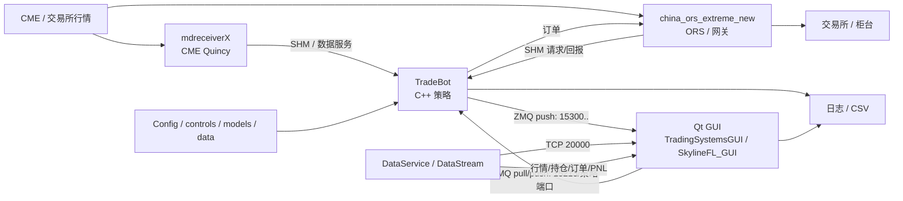

# 01 — 原始 TradeBot + Qt 前端总体架构

> 证据：**V** = 源码/配置/脚本确认；**I** = 目录/时间戳/日志推断；**P** = 计划/未验证。
> 详细证据见 `00-inventory.md`、`02-tradebot-core.md`、`03-qt-gui.md`、`04-config-data.md`、`05-build-deploy-ops.md`、`06-security-lineage.md`。

## 1. 一句话概括

这是 **2015 年的一套单机、多进程、SHM + ZMQ + TCP 的期货交易栈**：

```text
行情/柜台
  → mdreceiverX / ORS / DataService
  → SysV SHM / TCP
  → TradeBot（C++ 策略引擎）
  → ORS/网关 → 交易所
  → Qt GUI（TradingSystemsGUI / SkylineFL_GUI）
```

它不是现代 `quantlink-trading` 的 CTP 版本，而是更早的 **CME/SGIT/China 网关**时代：

- 行情接收是 `mdreceiverX`（CME Quincy 数据），不是 CTP MdSpi。
- 订单路由是 `/home/infra/prod/bin/china_ors_extreme_new`，源码在 `2/bld/build_dev_multi.20150330_1447/China`。
- 历史启动命令用的是 **Qt4 的 `TradingSystemsGUI`**；Qt5 `SkylineFL_GUI` 另有源码和 `3/GUI/SH` 部署态（2014-12-21），但源码树 2015-03-19 构建未部署。两套 GUI 的实际主用关系需现场确认。
- 无数据库；配置/控制/模型/行情/日志都是文件；订单/仓位/PnL 不持久化。

## 2. 历史真实启动顺序

这是用户提供、并已对照归档脚本核对的历史启动方式。它是理解依赖关系的关键：

```text
0) 把 /146/3 下的目录铺到 /home：
   /home/GUI
   /home/infra
   /home/leon
   /home/re
   /home/TradeBot
   以及 /usr/share/API

1) ORS / 订单路由
   /home/infra/prod/scripts/runORS_extreme_new.sh
   源码目录：2/bld/build_dev_multi.20150330_1447/China
   二进制：/home/infra/prod/bin/china_ors_extreme_new
   配置：/home/infra/prod/config/prod.china.ors_new.cfg

2) 行情接收
   /home/re/receive.sh
   （归档里是 receive.shBak；用户明确：receive_new.sh 不能启动，
     要把 receive.shBak 改成 receive.sh 再启动）
   源码目录：2/bld/build_dev_multi.20150330_1447/MDReceiverX
   二进制：mdreceiverX 或 mdreceiverX_bothfeeds
   配置：cme.recv.quincy.data.cfg

3) 策略
   /home/TradeBot/livescripts/RunStrategies.sh
   源码：/home/TradeBot/TradeBot_China
   典型命令：
   taskset -c 21 /home/TradeBot/TradeBot_China/main/TradeBot \
     --Live --controlFile /home/TradeBot/controls/control.GOLD_F_0_SFE.eve.ltp.20150725 \
     --startDate 20150725 --endDate 20150725 --strategyID 420 \
     --configFile /home/TradeBot/TradeBot_China/Connector/config_CHINA_CME.cfg \
     --adjustLTP 1 --logFile /home/TradeBot/log/...

4) 数据服务（二选一）
   /home/infra/dataservice_deploy/runDataService.sh
   或
   /home/infra/dataservice_deploy/runDataStream_CTP.sh

5) GUI
   /home/infra/TradingSystemsGUI/TradingSystemsGUI
```

### 2.1 顺序依赖

- **ORS 必须早于 TradeBot**：TradeBot 构造时 attach ClientStore/SHM；失败会抛 `IpcException`，而 `main.cpp` 的 catch 被注释，进程会 terminate（`02`）。
- **行情接收必须早于 TradeBot**：策略启动就要读 MD SHM；没有行情时可能启动但不会交易。
- **DataService 在 ORS 之后、GUI 之前**：GUI 通过 DataService 拉行情/持仓/订单/PNL；DataService 不在则 GUI 空/超时。
- **GUI 可以早于策略**：GUI 只是观察/控制面；策略未起时显示空/断线。
- **`receive.sh` 的异常**：归档 `receive_new.sh` 使用 `taskset -c -p 8 nohup ...`，按标准 util-linux 语法 `-p` 后应跟 PID，不是 CPU 列表；历史实际可能由包装脚本/旧版 taskset/人工绕过执行。用户明确说 `receive_new.sh` 不能启动，应使用 `receive.shBak` 改名后的 `receive.sh`（`mdreceiverX_bothfeeds`，CPU 5,6）。这是一个必须现场验证的启动坑（`05`）。

## 3. 进程/组件拓扑



> 上图的 ZMQ 端口/数据服务细节见 `03-qt-gui.md`；SHM/订单细节见 `02-tradebot-core.md`；启动脚本见 `05-build-deploy-ops.md`。

## 4. 组件职责

| 组件 | 职责 | 不负责 | 证据 |
|---|---|---|---|
| `china_ors_extreme_new` | 订单路由/柜台网关；接收策略请求、发交易所、回报；维护部分订单/持仓上下文 | 策略决策、GUI、行情展示 | `05`、`02` |
| `mdreceiverX` | CME/Quincy 行情接收，写入 SHM/DataService | 策略、订单 | `05`、`04` |
| `TradeBot` | 单策略进程：行情→指标→目标价→下单/撤单；订单状态、PnL、净仓、风控、信号 | GUI、账户级对账、持久化 | `02` |
| `DataService` | GUI 的数据后端：行情、持仓、订单、PNL、手工单转发 | 策略决策 | `03`、`05` |
| `TradingSystemsGUI`（Qt4） | 历史启动命令使用的 GUI：交易所 tab、策略/订单/持仓/PNL、手工单、平仓 | 交易执行；归档运行态日志大多为空，实际主用关系需确认 | `03`、`05` |
| `SkylineFL_GUI`（Qt5） | 另一套 GUI：策略表、合约窗、FairValue、ZMQ；`3/GUI/SH` 是部署态 | 交易执行；源码无 VCS，2015-03-19 构建未部署 | `03`、`00` |
| `infrastructure` | 共享 C++ 库：DataService、Connector、Ipc、Logger、CommonUtils、TradingSystemsGUI 控件 | 业务策略 | `00`、`05` |
| `Config/controls/models/data` | 策略配置、控制文件、模型参数、合约/费率/日期数据 | 运行时状态 | `04` |

## 5. 关键数据流

### 5.1 行情 → 策略

```text
CME/交易所
  -> mdreceiverX
  -> SHM / DataService
  -> TradeBot Connector
  -> Tick / Instrument
  -> Indicators
  -> 目标价（Dependant + 系数×差分/取值）
  -> SendOrder / 报价
```

- 单进程单策略；策略的行情/回报回调在一条线程里串行（`02`）。
- 指标是模型驱动的：model 首行 `Dependant` 定价格类型，其余行是系数×指标差分/取值。
- `--adjustLTP 1` 在 China 版用于单边盘口时用 LTP±tick 合成 book；这是运行参数，不是默认。

### 5.2 策略 → 订单 → 回报

```text
TradeBot SendOrder
  -> ORS 请求（SHM/网关协议）
  -> 交易所
  -> ORS 回报
  -> TradeBot 订单状态机 / PnL / 净仓
```

- 订单表以价格为主键；同侧同价不能重复挂单（`02`）。
- 成交/PnL/仓位是**策略本地账本**，不是交易所账户账本；没有自动对账（`02`、`06`）。
- 风控在策略内：`MAX_ORDERS`、`MAX_LOSS`、`UPNL_LOSS`、`STOP_LOSS`、拒绝计数、收盘窗口；没有统一 pre-trade 资金/保证金检查。
- `RunStrategies.sh` 的当前归档版本只启动一条 `GOLD_F_0_SFE.eve.ltp`（strategyID 420）；历史生产通过不同日期/人工脚本启动多条，不能假设一个脚本启动全部（`04`、`05`）。

### 5.3 策略/GUI 控制面

```text
GUI (Qt)
  <-> ZMQ: GUI 15213 bind PULL, 策略 15300.. bind PULL
  <-> DataService TCP 20000: 行情/持仓/订单/PNL/手工单
```

- GUI 的 ZMQ 是“端口即策略身份”：策略在 `15300+` 上 bind PULL；GUI push 到对应端口。没有认证/ACK；`ZMQ_DONTWAIT` 可能静默丢 Start/Stop（`03`、`06`）。
- 行情/持仓/挂单/成交不走 ZMQ，走 DataService 的 TCP 命令流。
- 手工单/撤单/平仓也通过 DataService/策略端口；日志只记“Sent new order”，审计不完整（`06`）。

### 5.4 配置/数据流

```text
Config/StrategyConfig.cfg + Connector/config_CHINA_*.cfg
  -> TradeBot 启动参数/全局配置
controls/control.*.<date>
  -> 每个策略的合约/模型/交易所/时段/腿
models/model.*
  -> 指标/阈值
data/{contractfile, fee, holidays, ...}
  -> 合约规格/费率/日历
```

- 2,006 个 control、1,958 个 model，但归一化后只有 24 种 control 内容、65 种 model 内容；大量是按日复制（`04`）。
- 控制文件是扁平目录 + 日期后缀；`session` 只是标签；时段是 GMT HHMM（`04`）。
- 没有数据库；`position.csv` 只有 ORS 侧时点快照；TradeBot 不读它；重启即空仓（`04`、`06`）。

## 6. 版本/资产谱系

| 资产 | 路径 | 状态 |
|---|---|---|
| TradeBot 源码 r2375 | `3/TradeBot/TradeBot_China` | SVN 干净 checkout，2015-06-10，权威源码 |
| TradeBot 旧版 | `3/TradeBot.bak`、`3/tempTradeBot` | r1936/r2023 备份，非权威 |
| TradeBot 运行副本 | `2/TradeBot` | 与 3 同名树逐字节相同，运行/备份 |
| Qt5 GUI 源码 | `3/dalong/FromDaya/SkylineFL_GUI` | 2014-11-20，未进 VCS；有 `3/GUI/SH` 部署态 |
| Qt4 GUI 运行态 | `3/infra/TradingSystemsGUI` | 历史启动命令使用；运行日志大多为空，实际主用关系待确认 |
| Qt5 部署目录 | `3/GUI/SH` | 2014-12-21 构建，有 Qt5 库/配置/日志；与源码 2015-03-19 构建不同 |
| 共享 infra | `3/dalong/infrastructure` | git 仓库，SCons，含 DataService/GUI 控件 |

关键结论：

- **源码 ≠ 线上二进制**：TradeBot 二进制 6/17 晚于源码 r2375 6/10，含未提交改动；GUI 线上 2014-12-21，3/19 构建未部署（`00`、`05`）。
- **SkylineFL_GUI 没有 VCS**：只有目录 + tarball，是最该先保存的资产（`00`、`06`）。
- **2/ 与 3/ 大量重复**：约 10.8GB 重复；`3/leon/log` 39GB 是最大单项（`00`）。

## 7. 关键架构事实

1. **单进程单策略**：生产按 control 文件启动 `TradeBot`；不是现代意义的单进程多策略容器。
2. **SHM 是实时总线**：行情/订单/回报通过 SHM；队列/结构体没有版本协商（`02`）。
3. **ZMQ 是 GUI↔策略控制面**：端口即身份，无认证/ACK；GUI 不是交易主链路（`03`）。
4. **DataService 是 GUI 数据后端**：行情/持仓/订单/PNL 走 TCP，和 ZMQ 是两条链（`03`）。
5. **无数据库/无持久化**：配置/控制/模型是文件；订单/仓位/PnL 在内存/日志；`position.csv` 是 ORS 时点快照（`04`）。
6. **两本账**：TradeBot 的策略净仓/PnL vs ORS/交易所账户仓位；没有自动对账（`02`、`06`）。
7. **起停靠 shell/cron + kill**：历史 cron 07:15–08:56 启，15:05/02:35 `pkill -9`；没有 systemd/优雅停机（`05`）。
8. **风控是策略内 + ORS/RMS**：没有统一资金/保证金/可平量 pre-trade gate（`02`、`06`）。
9. **安全边界薄**：root/VNC、ZMQ 绑所有网卡、无认证、配置/日志含凭据（见 06，不在本文复制值）。

## 8. 与后来 `quantlink-trading` 的架构差异（高层）

| 维度 | 2015 原始版 | 后来 `quantlink-trading` |
|---|---|---|
| 柜台 | CME/SGIT/China 网关 | CTP（SimNow/SimShengli） |
| 行情 | `mdreceiverX` + DataService | ORS CTP MdSpi + SHM |
| 订单 | ORS 网关 + 策略 SHM | ORS + CTP + SHM |
| 策略 | 单进程单策略；`RunStrategies.sh` | 一策略一进程；tbadmin 生成启动脚本 |
| GUI | Qt4 `TradingSystemsGUI` / Qt5 `SkylineFL_GUI` | tbadmin + Vue/Web |
| 管理面 | 无 DB；DataService/TCP | PostgreSQL + tbadmin |
| 持久化 | 基本无 | 部分 DB/文件/日志 |
| 风控 | 策略内 + ORS/RMS | 策略内 + ORS/RMS |
| 运维 | cron + `pkill -9` + VNC | cron + shell + 部分看门狗 |

> 这不是“同一系统的版本迭代”那么简单：柜台、GUI、管理面、数据层都换过。详细谱系见 `00`、`06`。

## 9. 架构风险（先看这几条）

- **源码/二进制漂移**：线上行为不能只用 r2375 源码解释（`00`、`06`）。
- **无持久化/两本账**：重启归零，交易所仍有仓；`kill -9` 可能留仓（`02`、`06`）。
- **SHM 无背压/无版本**：丢消息/结构体不一致会静默错乱（`02`）。
- **ZMQ 无认证/端口即身份**：任何能连端口的人可 Start/Stop/下单；`DONTWAIT` 会丢命令（`03`、`06`）。
- **DataService 阻塞 UI**：GUI 线程连接/读取可能卡 30 秒（`03`）。
- **启动脚本脆弱**：`receive_new.sh` 的 `taskset -c -p 8` 语义不成立；`receive.shBak` 才是历史回滚方案（`05`）。
- **风控缺口**：`MAX_POS_SIZE=1000000` 在 SFE 下事实失效；`MAX_ORDERS=450` 才是硬闸门（`04`）。

## 10. 继续阅读

- 磁盘/版本：`00-inventory.md`
- 后端核心：`02-tradebot-core.md`
- Qt GUI：`03-qt-gui.md`
- 配置/数据：`04-config-data.md`
- 构建/部署/启动：`05-build-deploy-ops.md`
- 安全/谱系：`06-security-lineage.md`
- 保存/复刻：`07-preservation-playbook.md`
