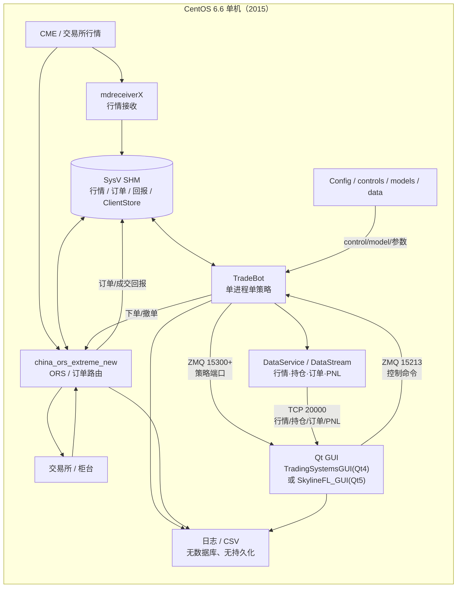

# 146 能否给一个大致的架构图？

## 短答

可以。按 2015 年历史启动顺序，核心是：

```text
CME/交易所行情 -> mdreceiverX -> SHM
CME/交易所      -> china_ors_extreme_new (ORS/网关)
SHM <-> TradeBot (单进程单策略) -> ORS -> 交易所
TradeBot <-> Qt GUI（ZMQ 控制/状态）
DataService <-> Qt GUI（TCP：行情/持仓/订单/PNL/手工单）
Config/controls/models/data -> TradeBot
```

## 架构图



## 三条主链路

| 链路 | 路径 |
|---|---|
| 行情 | CME/交易所 → `mdreceiverX` → SHM → `TradeBot` |
| 订单 | `TradeBot` → `ORS`/网关 → 交易所；回报经 SHM 回 `TradeBot` |
| GUI | `TradeBot` → `DataService` → GUI（TCP）；GUI ↔ `TradeBot`（ZMQ 控制命令） |

## 历史启动顺序

```text
1. ORS：/home/infra/prod/scripts/runORS_extreme_new.sh
2. 行情：/home/re/receive.sh
   （归档 receive_new.sh 不能启动；用 receive.shBak 改名）
3. 策略：/home/TradeBot/livescripts/RunStrategies.sh
4. 数据：runDataService.sh 或 runDataStream_CTP.sh
5. GUI：/home/infra/TradingSystemsGUI/TradingSystemsGUI
```

## 关键特征

- 单机、多进程；ORS、行情接收、TradeBot、DataService、GUI 分进程。
- 单进程单策略；`RunStrategies.sh` 当前归档只启动一条 `GOLD_F_0_SFE.eve.ltp`（strategyID 420）。
- 两套 GUI：历史启动命令用 Qt4 `TradingSystemsGUI`；`3/GUI/SH` 是 Qt5 `SkylineFL_GUI` 的部署态。
- 无数据库；配置/控制/模型是文件；订单/仓位/PnL 不持久化。
- ORS 和行情接收必须先于 TradeBot；DataService 在 GUI 之前。

## 证据

- `146/01-architecture.md`
- `146/appendix/startup-matrix.md`
- `146/05-build-deploy-ops.md`
