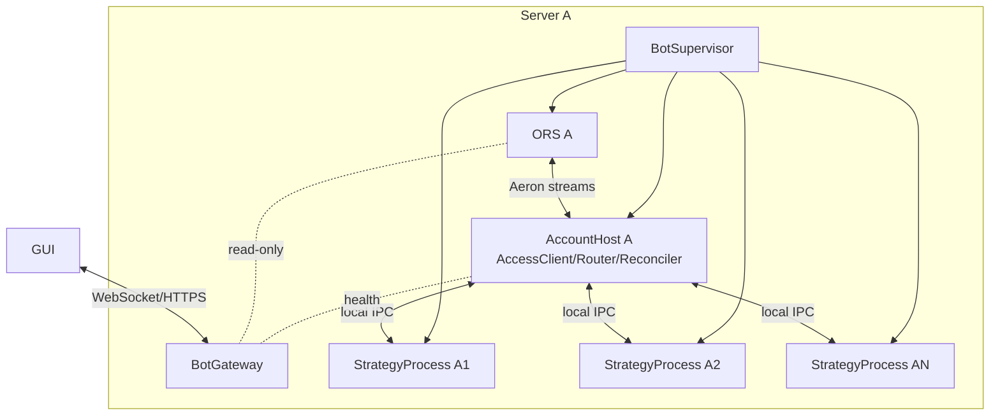

# 按照账户隔离，新系统的大致结构是什么？

## 短答

按账户隔离 + 一策略一进程：

```text
1 个 Account = 1 个 ORS = 1 个 AccountHost = 1 个 AccessClient
1 个 Strategy = 1 个 StrategyProcess
1 个 Server = 1 个 BotSupervisor + 1 个 BotGateway
```

Account 是交易/会话边界；Server 只是部署边界。

## 架构图

```text
Server A
├─ BotSupervisor
├─ BotGateway（只读数据/控制网关，WebSocket/HTTP）
│
├─ Account A
│   ├─ ORS A
│   ├─ AccountHost A
│   │   ├─ AccessClient
│   │   ├─ AccessRouter
│   │   ├─ PositionReconciler
│   │   ├─ AccountRiskGate
│   │   └─ ClientOrderIdAllocator
│   ├─ StrategyProcess A1
│   ├─ StrategyProcess A2
│   └─ StrategyProcess AN
│
└─ Account B（可选）
    ├─ ORS B
    ├─ AccountHost B
    ├─ StrategyProcess B1
    └─ StrategyProcess B2
```

Mermaid 版本：



## 各进程职责

| 进程 | 职责 |
|---|---|
| `BotSupervisor` | 每 Server 一个；启停/监控 ORS、AccountHost、StrategyProcess；不持交易状态 |
| `ORS` | 每 Account 一个；一个 venue/account 会话；订单路由/回报 |
| `AccountHost` | 每 Account 一个；唯一 AccessClient、订单入口、`clientOrderId`、账户对账、账户风控 |
| `StrategyProcess` | 每策略一个；策略逻辑、订单意图、FillLedger、PositionBook、健康 |
| `BotGateway` | 只读订阅/聚合行情、订单、持仓、账户、策略状态；向 GUI 提供 WebSocket/HTTP；不发单 |

## 订单路径

```text
StrategyProcess
  -> OrderIntent（本机 IPC）
  -> AccountHost
      -> clientOrderId（DB 原子分配）
      -> DB PENDING
      -> AccessClient.submit
      -> Aeron ORDER_REQUEST
      -> ORS
      -> 交易所

ORS
  -> Aeron EXECUTION
  -> AccountHost.AccessRouter
  -> 按 strategyKey 回对应 StrategyProcess
```

- 策略进程不直接持有 `AccessClient`；
- 账户内只有一个订单发布者：AccountHost；
- `clientOrderId` 账户级唯一；
- 账户快照只用于对账，不 seed 策略仓位。

## 账户隔离维度

| 维度 | 隔离方式 |
|---|---|
| ORS | 每 Account 一个 |
| AccountHost | 每 Account 一个 |
| AccessClient | 每 Account 一个 |
| Aeron stream | 每 Account 独立 stream base；不能共用默认 1001/2001/2003 |
| DB | 所有表带 `account_id` |
| clientOrderId | 每 Account 一个 counter |
| strategyKey | Account 内唯一 |
| 仓位/对账/风控 | 按 Account 独立 |
| 日志/健康 | 带 account/strategy 标签 |

## 多 Account 部署

- 可以一台 Server 跑多个 Account；
- 但必须：每 Account 独立 ORS、AccountHost、stream base、DB key、counter、资源；
- 不共享 AccessClient；
- 一个 ORS 不承载多个 CTP investor；
- 不是“1 Server = 1 Account”，而是“1 Account = 1 ORS = 1 AccountHost”。

## 关键设计选择

- 不建议每个 StrategyProcess 自带 AccessClient：同一账户会有 N 个 session/publication，`clientOrderId`、ready、对账都会复杂。
- 采用 AccountHost 统一账户传输，StrategyProcess 只通过本机 IPC 发订单意图。
- 不用 ZMQ；GUI 通过 BotGateway 的 WebSocket/HTTP。
- 数据库是唯一恢复源；无文件 state。

## 启动/恢复

```text
DB/schema/lease
  -> ORS session READY
  -> AccountHost/AccessClient READY
  -> 恢复 DB 订单/仓位/counter
  -> 撤销 persisted open order
  -> 启动 StrategyProcess
  -> 账户快照对账
  -> 对账通过后 arm
```

启动默认 `armed=false`；对账失败保持 disarmed。

## 一句话

**一 Server 一个 Supervisor；一 Account 一个 ORS + AccountHost；一 Strategy 一个 StrategyProcess。**  
AccountHost 统一账户传输/订单/对账/风控，StrategyProcess 只跑策略；账户之间用独立 ORS、stream base、DB key、counter 和策略 key 隔离。
