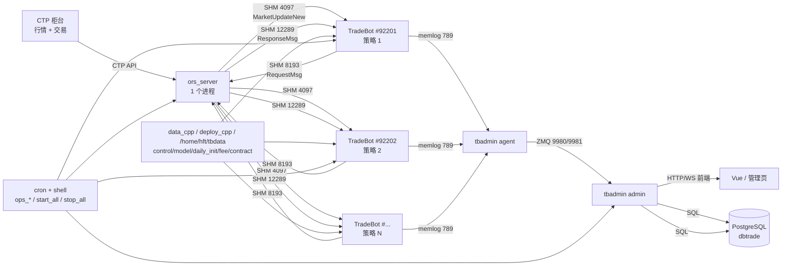

# 01 — 系统架构与端到端数据流

> 证据约定：**V** = 代码/配置/脚本直接确认；**I** = 结构推断；**P** = 计划/文档描述但未实现。
> 详细实现见 `02-runtime-strategy.md`、`03-ors-connectors.md`、`04-admin-control-plane.md`、`05-data-model.md`、`06-build-deploy-ops.md`、`07-operations-runbook.md`、`08-security-gaps.md`。
> 范围排除：`web-go` / Go Dashboard 的内部实现不在本档案；本文不把它画进交易主链路。

## 1. 一页结论

`quantlink-trading` 不是“一个多策略交易平台”，而是 **一套单机、多进程、按策略启动的 C++ 期货交易栈**：

- **1 个 `ors_server`**：接 CTP 行情/交易，做 SHM 编解码和静态 RMS 前置检查。
- **N 个 `TradeBot`**：生产上 **一个策略一个进程**；每个进程一个 control 文件、一个 `strategyID`、一个策略对象。
- **1 套 SysV SHM**：行情 4097、订单请求 8193、订单回报 12289、ClientStore 16385；memlog 789。
- **1 个 `tbadmin`**：agent/admin 旁路监控与控制面，不参与交易主链路。
- **1 个 PostgreSQL `dbtrade`**：策略注册/手工单/时段/合约元数据，不是运行时仓位真相。
- **文件是策略启动真相**：control/model/`daily_init.<sid>`/`fee.csv`/`contractfile` 比 DB 更靠近 TradeBot。
- **没有 HA、没有 systemd 交易单元、没有异地备份/PITR、没有自动持仓对账**。

最重要的架构事实：

1. **一策略一进程**是生产部署模型；`main.cpp` 的 N-control-file 循环是遗留/回归路径，且缺少 per-strategy ID/路由隔离。
2. **策略账本与账户净额是两套真相**：TradeBot 维护 `m_netpos`，ORS/CTP 维护账户净额/`position.csv`，两者不自动对账。
3. **所有策略默认共用 `ACCOUNT=OWN`**：账户级净额真实存在，但没有账户级对冲器；策略间可能隐式对冲。
4. **管理面不是权威**：tbadmin/前端/memlog 只展示/转发，可能陈旧；不能拿它当交易状态真相。
5. **热路径没有数据库**：TradeBot 的行情→决策→发单不读 DB；DB/HTTP/管理面不在 tick 路径。
6. **SHM 是跨语言二进制契约**：没有 IDL/版本协商，结构体/队列大小必须人工保持一致。
7. **风控分两层**：ORS/RMS 的静态额度检查 + TradeBot 的策略内 kill switch；两者都不检查可用资金/保证金（详见 03/08）。
8. **停止流程不可靠**：`SIGTERM` 不保证平仓，`stop_all` 最终可能 `kill -9`；`tbstop` 也不是“必然平光”。

## 2. 进程/主机拓扑



> 当前生产逻辑上是一台 190 主机；上图是进程边界，不是多机部署。`tbadmin`/前端/DB 故障不影响 TradeBot/ORS 继续交易（但监控/配置会失效）。

### 2.1 进程职责

| 组件 | 职责 | 不负责 | 证据 |
|---|---|---|---|
| `ors_server` | CTP 行情/交易 API、SHM 编解码、订单路由、静态 RMS 前置检查、`position.csv` 时点快照 | 策略决策、策略 PnL、账户级对冲、可用资金/保证金校验 | `03-ors-connectors.md` §0/§2/§5/§8 |
| `TradeBot` | 单策略行情处理、指标、报价/发单、订单状态、策略净仓/PnL、策略内风控、squareoff | 账户净额、跨策略路由、管理面、DB 配置读取 | `02-runtime-strategy.md` §0/§3/§5/§6 |
| `tbadmin agent` | 读本机 memlog/SHM，转发策略状态/订单/持仓等到 admin | 交易决策、持久化仓位真相、风控 | `04-admin-control-plane.md` §1/§2 |
| `tbadmin admin` | 聚合 agent 数据、派生展示量、写少量管理表、ZMQ/前端广播 | 交易主链路、权威 PnL/仓位、审计完整性 | `04-admin-control-plane.md` §2/§3/§8 |
| Vue/管理页 | 配置/监控/有限手工操作 | 交易执行、风控、权威数据源 | `04-admin-control-plane.md` §5 |
| PostgreSQL | `tbhft_strategy` 策略注册、`tbhft_man_order` 手工单、`tbtrade_sections` 时段、合约元数据、审计/遗留表 | 运行时策略仓位/PnL、open order、实时行情 | `05-data-model.md` §0/§4 |
| 文件数据 | control/model/`daily_init.<sid>`/`fee.csv`/`contractfile`/`session_rules.csv` 等 | 跨策略对账、实时状态 | `02-runtime-strategy.md` §1.4/§5.4、`05-data-model.md` §5 |
| cron/shell | 会话启停、数据快照/回灌、日志轮转、看门狗、DB feed | 交易逻辑、权威状态 | `06-build-deploy-ops.md` §6、`07-operations-runbook.md` §2 |

## 3. 端到端数据流

### 3.1 行情：CTP → ORS → SHM → TradeBot

```text
CTP MdSpi
  -> ORS MdSpi/MDHandler
  -> MarketUpdateNew
  -> SysV SHM 4097 (0x1001)
  -> TradeBot Connector 轮询
  -> CommonClient::SendINDUpdate
  -> 指标 QuoteUpdate/TickUpdate
  -> m_INDCallBack（目标价）
  -> m_MDCallBack（策略）
  -> SendOrder / SendBidOrder / SendAskOrder
```

关键点：

- TradeBot 的行情回调与订单回报回调在**同一线程**串行执行，策略内部无锁（`02-runtime-strategy.md` §0）。
- 回调顺序是 **指标更新 → 目标价 → 策略回调**；风控检查（亏损/时间/拒单）在发单之后才跑，属于准实时 kill switch，不是 pre-trade gate（`02` §3/§6）。
- ORS 订阅范围是全期货，期权/组合可能被 `ProductClass` 过滤；具体见 `03` §6.2。
- SHM 队列无背压，`isFull()` 恒 false，丢消息静默；这是复刻时必须优先修的可靠性问题（`03` §3.3）。

### 3.2 下单/撤单：TradeBot → SHM 8193 → ORS → CTP

```text
Strategy SendNewOrder
  -> ExecutionStrategy 订单表（价格为主键）
  -> CommonClient::SendNewOrder
  -> RequestMsg
  -> SHM 8193 (0x2001)
  -> ORS 轮询
  -> RMS 检查（静态额度/频率）
  -> CTP ReqOrderInsert / ReqOrderAction
  -> CTP 回报
```

关键点：

- TradeBot 侧订单表以**价格为主键**：同一侧同一价格只能有一张单，重复价格直接拒发（`02` §0/§4）。
- ORS **不支持改单**：`SendModifyOrder` 无条件 reject；策略的改单在实盘会变成 `MODIFY_ORDER_REJECT`（`03` §0/§2.9）。
- ORS 按本地持仓镜像决定开/平/平今/平昨；数量超过可平量时**整笔转开仓**，不自动拆单（`03` §4.5）。
- RMS 是 ORS 侧静态额度检查；生产只启用少量规则；不检查可用资金/保证金/可平量/涨跌停/时段（`03` §5；`08`）。
- `clientOrderId`/`OrderID`/CTP `OrderRef` 是三套 ID；TradeBot 侧与原 ORS 侧映射是复刻重点（`02` §4.3、`03` §4.2/§4.3）。

### 3.3 回报/成交：CTP → ORS → SHM 12289 → TradeBot

```text
CTP OnRtnOrder / OnRtnTrade
  -> ORS
  -> ResponseMsg
  -> SHM 12289 (0x3001)
  -> TradeBot Connector
  -> CommonClient::ORScallback
  -> ExecutionStrategy::ORSCallBack
  -> 订单状态机 / ProcessTrade
  -> m_netpos / PnL / 订单表
```

关键点：

- 非配对策略走 `m_orderIDStrategyMap` 按 ORS OrderID 路由；配对/蝴蝶策略 `useArbStrategy=1` 时直接调用 `m_simConfig->m_execStrategy`，这是一个全局指针，**多组配对策略会串单**（`02` §0/§4；`main.cpp:283-293`）。
- TradeBot 的 `m_netpos` 由自己的成交累计；ORS 侧账户净额是另一套账；两者不自动对账（`02` §5.7）。
- 成交幂等性弱：TradeBot 侧按增量累加，重复/乱序回报没有强幂等键（`02` §4.5；`03` §4.6）。
- ORS 重启会丢内存订单上下文，旧单回报查不到、旧单无法撤；这是最危险的操作之一（`03` §0/§8.4）。

### 3.4 仓位/PnL：两套真相

| 账本 | 位置 | 谁维护 | 恢复来源 | 用途 |
|---|---|---|---|---|
| 策略净仓 `m_netpos` | TradeBot 进程内存 | 该策略的成交累计 | pair: `daily_init.<sid>`；MMF/hedge: `../position/<sid>`；其余无恢复 | 策略报价/平仓/风控 |
| 账户净额/持仓 | ORS 内存 + `position.csv` | ORS/CTP | 启动查询 CTP + `position.csv` | ORS 开平仓判断、账户级事实 |
| 手工仓 | `tbadmin_position` / 前端 | tbadmin/管理面 | DB | 管理面展示/人工操作 |
| PnL | TradeBot 内存 + 日志/memlog | TradeBot | 无持久化恢复 | 策略止损/监控 |
| 订单审计 | `tbhft_man_order` 等 DB 表 | tbadmin/agent | DB | 手工单/审计（不完整） |

结论：**DB 不是运行时仓位真相，TradeBot 不是账户真相。** 复刻时如果只做一个账本，必须明确业务上接受哪种口径；不要假设系统会自动对账。

### 3.5 管理面：memlog → agent → admin → 前端

```text
TradeBot SendMonitorStratStatus/Pos/PNL/...
  -> memlog SHM 789
  -> tbadmin agent
  -> ZMQ 9980/9981 (toadmin)
  -> tbadmin admin
  -> 内存聚合 + 少量 DB 写
  -> HTTP/WS / 前端
```

关键点：

- tbadmin 是旁路；它死了交易继续，但监控/部分控制失效（`04` §0）。
- 策略状态是事件推送 + 进程内存，没有回放/序号/心跳；丢一条消息前端可能永久停旧值（`04` §0/§8）。
- 前端“仓位/账户”页在仓库链路里没有可靠数据源；`-99` ORS 仓位只有测试工具写（`04` §0/§3）。
- 管理面命令通道是无认证 ZMQ，且能触发 shell/SQL；安全边界必须重画（`08` §0/§1/§2）。

### 3.6 配置/策略部署：DB → 文件 → 进程

```text
RDS / tbhft_strategy
  -> tools/strategy_sync (10:30/20:30)
  -> PostgreSQL dbtrade.tbhft_strategy
  -> tbadmin agent / admin
  -> control/model 文件 + config_CHINA.<sid>.cfg
  -> tbadmin start script
  -> nohup ./TradeBot --Live --controlFile ... --strategyID <sid>
```

关键点：

- TradeBot **不读 `tbhft_strategy`**；它只吃文件。DB→文件的物化在 tbadmin agent（`05` §0）。
- `tbhft_strategy` 是生产全量镜像，不等于 190 本机在跑的策略清单（`05` §0）。
- `strategy_sync` 有 diff/备份/冲突处理，是全仓质量最好的管理代码；但它会覆盖 `active/core/corebind/path`，且 `ref` 类型有冲突（`04` §4；`05` §6）。
- 策略启动默认 `m_Active=false`；Live 模式必须 `tbstart`/SIGUSR1 激活（`02` §0）。

## 4. 所有权与真相矩阵

| 数据 | 权威来源 | 次要来源 | 不要当成权威 |
|---|---|---|---|
| 账户净仓/账户权益 | CTP/ORS（账户级） | `position.csv`（时点） | TradeBot `m_netpos`、前端 |
| 策略净仓 | TradeBot `m_netpos` | `daily_init.<sid>` / `../position/<sid>` | 账户净仓、tbadmin |
| open order | TradeBot 内存 + ORS 内存 | 日志/memlog | DB（没有完整 open order 表） |
| 成交/PnL | TradeBot 成交累计 + 日志 | memlog | DB、前端 |
| 策略注册/部署 | `tbhft_strategy` + control/model 文件 | `config_CHINA.*.cfg` | 前端缓存 |
| 手工单/审计 | `tbhft_man_order`（不完整） | 日志 | 前端内存 |
| 交易时段 | `tbtrade_sections` / `session_rules.csv` / `trading_days.txt` | cron 门控 | 前端 |
| 合约规格/费率 | `contractfile` / `fee.csv` | `tbinstrument_info` | 前端 |
| 配置密钥 | 现场文件/环境（不入 git） | — | 仓库默认值/日志 |

## 5. 关键不变量（复刻时必须显式决定）

1. **一策略一进程**：生产路径如此；`main.cpp` 的 N-control-file 循环不是受支持的多策略运行时（没有 per-strategy ID/路由隔离）。唯一例外是 `--controlList --optionStrategy 1` 的 OptionManage 容器（共享一个 `OptionManager`）。
2. **一个账户的净额只有一个**：所有策略默认 `ACCOUNT=OWN`，交易所只看账户净额；策略间可能隐式对冲，系统没有账户级对冲器。
3. **策略净仓不等于账户净仓**：不要用账户净仓 seed 策略，也不要用策略账本覆盖账户事实；如果业务不能接受，配置层应禁止同账户同合约多策略。
4. **TradeBot 不读 DB**：DB 只用于管理面/策略注册；运行时输入是文件。
5. **热路径不做阻塞 IO**：TradeBot tick 路径没有 HTTP/JDBC/管理面调用；加入这些会破坏延迟和确定性。
6. **SHM 是二进制契约**：结构体大小、队列槽数、key、读写方必须一致；没有版本协商。
7. **RMS 不是完整风控**：它做静态额度/频率；不检查资金/保证金/可平量/涨跌停/时段。策略内 kill switch 也在发单之后。
8. **管理面不是交易真相**：tbadmin/前端/memlog 可能丢消息/陈旧；交易决策不能依赖它们。
9. **停止不是平仓保证**：`SIGTERM`/`stop_all`/`tbstop` 都有缺口；复刻必须单独设计可靠的 flatten/closeout。
10. **没有 HA/备份/PITR**：单机单盘；复刻时必须先补运维底座，否则只是复制脆弱性。

## 6. 故障域与影响

| 故障 | 交易是否继续 | 影响 | 证据 |
|---|---|---|---|
| `tbadmin`/前端挂 | 是 | 监控/配置/手工操作失效；策略继续 | `04` §0/§8 |
| PostgreSQL 挂 | 是（TradeBot 不读 DB） | 策略同步/管理面/审计失效；平仓回写 `posdetail` 可能失败 | `05` §0/§4；`04` §8.4 |
| ORS 挂/重启 | 否（无行情/无路由） | 所有策略停单；旧单上下文丢失；需按安全顺序重启 | `03` §0/§8.4 |
| 单个 TradeBot 挂 | 其他策略可继续 | 该策略仓位/订单可能残留；无策略级 watchdog | `02` §0/§7；`07` §6.3 |
| CTP 断连 | 否（该 ORS 下所有策略） | 行情/订单/回报中断；重连/双登录风险 | `03` §8.2/§8.8 |
| SHM 满/损坏 | 部分/否 | 静默丢消息或进程异常；需清理重启 | `03` §3.3/§8.3 |
| 磁盘满 | 可能继续但很快失败 | 日志/core/DB/文件写失败 | `07` §6.9 |
| 配置/模型/日初文件缺失 | 启动 exit 或策略错误 | 策略无法启动/持仓恢复错误 | `02` §0/§1.4 |
| 主机坏 | 否 | 无异地备份/PITR；只能重建最小集 | `07` §7；`08` §0 |

## 7. 实现状态：哪些是“真的”

| 能力 | 状态 | 说明 |
|---|---|---|
| CTP ORS + SHM + TradeBot 单策略 | **已实现/生产使用** | 核心链路；见 02/03 |
| 多策略同进程 | **不支持（遗留循环）** | 生产一策略一进程；OptionManage 例外 |
| 账户级对冲 | **没有** | 只有账户净额/隐式净额；见 02 §6.7 |
| 自动持仓对账 | **没有** | 策略账本与 ORS 账户净额不自动对账 |
| pre-trade 资金/保证金检查 | **没有** | RMS 不看 available/margin；见 03 §5.7 |
| 可靠 flatten/closeout | **部分/不可靠** | SIGTERM/stop_all 有缺口；见 02 §0/§5.5、07 §6 |
| 管理面前端 | **部分可用** | 有断链/陈旧/无认证；见 04/08 |
| DB 备份/PITR | **没有** | 同盘表备份不算；见 05 §7 |
| 异地备份 | **没有** | `docs/RISK_NO_OFFSITE_BACKUP.md` 明确接受风险 |
| systemd/HA | **没有** | cron + shell；见 06/07 |
| 审计完整性 | **弱** | 命令/手工单/配置变更无不可篡改审计；见 08 |

## 8. 复刻者应该先做的架构决策

1. **继续一策略一进程，还是重做多策略运行时？**
   - 最安全：保留一策略一进程，先修 ORS/停止/监控。
   - 要单进程多策略：必须重做 per-strategy ID、路由、OptionManager、PnL/持仓归属；不要复用现有 `main.cpp` 循环。
2. **策略账本与账户净额如何对账？**
   - 最小：策略账本 + 定期账户快照对账 + 不一致 fail closed。
   - 不要用账户净额 seed 策略，除非业务明确接受。
3. **风控放在哪一层？**
   - 最小：策略内 pre-trade gate + ORS/RMS 静态限额 + 账户级敞口 gate。
   - 不要只依赖 ORS RMS；它不检查资金/保证金/可平量。
4. **状态存储用什么？**
   - 现有：文件（control/model/daily_init/position）+ DB（策略表/手工单）+ SHM（实时）。
   - 改进：把策略仓位/open order 做成可恢复的持久状态；明确 DB vs 文件的真相。
5. **停止/平仓如何保证？**
   - 单独设计 flatten 工具/流程；不要依赖 `SIGTERM`/`stop_all`。
6. **管理面安全边界怎么画？**
   - 不要把 ZMQ/HTTP 管理面暴露在不可信网络；加认证/授权/审计；禁止 `popen()` 外部输入。

## 9. 继续阅读

- 运行时/策略层：`02-runtime-strategy.md`
- ORS/CTP/RMS/SHM/回测：`03-ors-connectors.md`
- tbadmin/前端/策略同步：`04-admin-control-plane.md`
- DB/文件数据模型：`05-data-model.md`
- 构建/部署/启停/回滚：`06-build-deploy-ops.md`
- 运维/监控/故障/备份：`07-operations-runbook.md`
- 安全/风险/改进：`08-security-gaps.md`
- 复刻步骤/验收：`09-replication-playbook.md`
